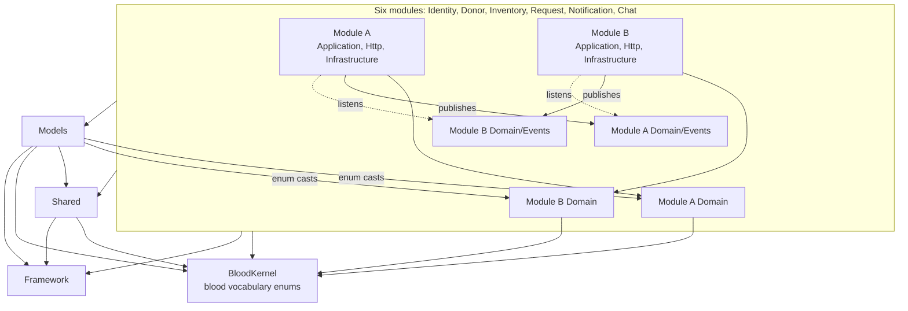
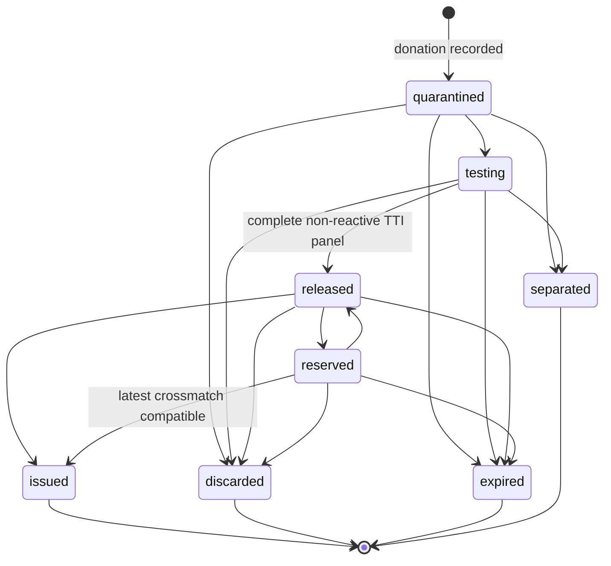
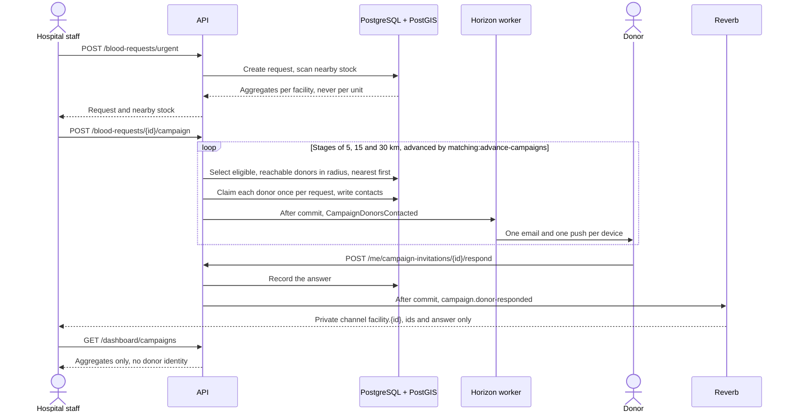

# BloodLink

[](https://github.com/Falllll/bloodlink/actions/workflows/ci.yml)

Blood bank management API for Indonesian blood services: donor registry, eligibility screening, inventory tracking with expiry-aware allocation, and hospital blood requests.

This repository is the backend only. It is headless — there are no Blade views and `routes/web.php` is permanently empty. The clients live in their own repositories and consume this API over `/api/v1`:

- [`Falllll/bloodlink-web`](https://github.com/Falllll/bloodlink-web) — Next.js
- [`Falllll/bloodlink-mobile`](https://github.com/Falllll/bloodlink-mobile) — Expo

The API is specified in [`docs/api/openapi.yaml`](docs/api/openapi.yaml), served at `GET /api/v1/openapi.yaml` and rendered at `/docs/`.

## Status

| Phase | Scope | State |
|---|---|---|
| F0–F5 | Foundations, auth & RBAC, donors & eligibility, inventory & lab, requests & matching, notifications & realtime | Done |
| F6–F7 | Web and mobile clients, in their own repositories | In progress |
| F8–F9 | Testing and documentation | In progress |

## Stack

| | |
|---|---|
| Runtime | PHP 8.5, Laravel 13 |
| Database | PostgreSQL 17 + PostGIS 3.5 |
| Cache, session & queue | Redis 7, with Horizon as the only worker manager |
| Realtime | Laravel Reverb (WebSocket) |
| Object storage | Garage, a self-hosted S3-compatible store (AGPL-3.0) replacing MinIO |
| API authentication | Sanctum bearer tokens, stateless |
| Quality | Pest, Larastan, Pint, Deptrac, gitleaks |

Six services run under Docker Compose:

| Service | Image / build | Port | Purpose |
|---|---|---|---|
| `app` | build `docker/php/Dockerfile` | `8000:8000` | Laravel API |
| `worker` | same build, `php artisan horizon` | — | Horizon, the only worker manager |
| `reverb` | same build, `php artisan reverb:start --host=0.0.0.0 --port=8080` | `8080:8080` | WebSocket |
| `db` | `postgis/postgis:17-3.5` | `5432:5432` | PostgreSQL + PostGIS |
| `redis` | `redis:7-alpine` | `6379:6379` | Cache, session, queue, optional donor GEO index |
| `garage` | `dxflrs/garage:v2.4.1` | `3900:3900` | S3-compatible object storage |

Named volumes: `db-data`, `garage-meta`, `garage-data`.

Every tool here is free and open source. There is no paid service anywhere in the pipeline.

## Architecture

A modular monolith — one deployable, with the boundaries of separate services drawn inside it and enforced by a machine rather than by convention.

```
app/
  Models/            Eloquent models
  Shared/            cross-module building blocks: response envelope,
                     error codes, trace-id and idempotency middleware
  Modules/
    Identity/  Donor/  Inventory/  Request/  Notification/  Chat/
      Domain/ Application/ Http/ Infrastructure/ Database/ Tests/
```

| Module | Responsibility |
|---|---|
| Identity | Users, staff accounts, facilities, authentication and authorization, audit |
| Donor | Registration, eligibility, appointments, recorded donations |
| Inventory | Units from intake through lab testing to release, storage, transfers |
| Request | Hospital requests, FEFO allocation, crossmatch, transfusion, donor call-up campaigns |
| Notification | Rendering and sending email and push, device tokens, history, category preferences |
| Chat | Visitor conversations and escalation to facility staff |

Modules never reach into each other's internals; only domain events cross a module boundary. `deptrac.yaml` encodes that rule in 23 layers:

- A module's application code may use **its own** domain plus the **events of every module**, never another module's domain or application code.
- Events depend on nothing, so they cannot smuggle a type across a boundary.
- A domain may depend only on `BloodKernel` — no framework, no `Shared`, no models.
- `Shared` may use the framework and `BloodKernel`, but neither `Models` nor any module.
- `Models` may depend on every domain, for enum casts. This inversion is deliberate.
- The barcode library is reachable only from Inventory.

CI runs Deptrac with `--fail-on-uncovered`, so code that no layer covers fails the build.



The dotted arrows are the only way one module learns anything about another.

A blood unit moves through a status graph, `BatchStatus`. `released` and `issued` are gated: release needs a complete non-reactive TTI panel, and issue needs the latest crossmatch to be compatible.



An emergency request first looks for stock nearby, then calls donors outward in stages. A person starts the campaign; the scheduler only advances and closes it.



**Notification channels: email and push only.** SMS and the WhatsApp Business API are billed per message, while donor call-up campaigns fan out to dozens or hundreds of recipients at once — an unbounded cost on a project with no revenue. Email over a free SMTP provider and FCM push carry no per-message cost, so they are the only channels the system sends on. The restriction lives in one place, `ChannelPolicy`, fed from `config/notification.php`; adding a channel means adding its enum case and its sender on the same day, and a config line alone is rejected at boot.

## API conventions

Every successful response is enveloped:

```json
{ "data": {}, "meta": {} }
```

Every failure uses the same shape, whatever went wrong:

```json
{
  "error": {
    "code": "VALIDATION_FAILED",
    "message": "Validation failed.",
    "details": {},
    "trace_id": "0f8c2a5e-..."
  }
}
```

Clients branch on `error.code`, never on `error.message`. Codes are a stable contract; messages are free to change or be translated. This matters more than it looks: BloodLink refuses requests for medical safety reasons — a unit that has not cleared lab testing, an incompatible blood group, a donor who has not waited long enough — and a client has to be able to tell a medical refusal from a broken server without pattern-matching on prose.

Every response carries an `X-Request-Id` header. Send your own to correlate a client action with server logs, or one is generated for you. The same value appears as `error.trace_id` and on every log line belonging to that request, including work that continues in the queue.

Write requests (`POST`, `PUT`, `PATCH`) require an `Idempotency-Key` header: a UUID generated once per user action and reused on every retry of that same action. Repeating a key replays the stored response instead of creating a second record. The clients are a mobile app used in the field and hospital staff on unreliable connections, so a duplicate submission is a matter of when, not if — and a duplicated blood request allocates scarce units twice.

List endpoints paginate by cursor, not offset. Filterable and sortable columns are declared per resource on an allowlist; anything outside it is rejected with `422` rather than silently ignored.

## Getting started

```bash
git clone https://github.com/Falllll/bloodlink && cd bloodlink
cp .env.example .env
```

Fill these in `.env` first. Compose refuses to start while any of the first four is empty, and it names the missing variable. `.env.example` already provides `DB_PASSWORD` and `AWS_BUCKET`, the other two required variables.

| Variable | Generate with |
|---|---|
| `GARAGE_RPC_SECRET` | `openssl rand -hex 32` |
| `GARAGE_ADMIN_TOKEN` | `openssl rand -base64 32` |
| `AWS_ACCESS_KEY_ID` | `echo GK$(openssl rand -hex 12)` |
| `AWS_SECRET_ACCESS_KEY` | `openssl rand -hex 32` |
| `REVERB_APP_ID`, `REVERB_APP_KEY`, `REVERB_APP_SECRET` | Any random strings, for example `openssl rand -hex 16` |

Compose does not require the Reverb values, but while they are empty every broadcast fails in the worker even though the stack looks healthy.

Then, in this order:

```bash
docker compose build
docker compose run --rm --no-deps app composer install
docker compose run --rm --no-deps app php artisan key:generate
docker compose up -d
docker compose exec app php artisan migrate --seed
```

The order matters. The source tree is mounted over the image, so `vendor/` must exist before `app` can boot. And `.env` is read when a container is created, so `APP_KEY` has to be generated before `up`, or the containers keep running with an empty key and seeding fails.

| Port | Service |
|---|---|
| 8000 | API |
| 8080 | WebSocket |
| 5432 | PostgreSQL |
| 6379 | Redis |
| 3900 | Garage |

Verify it:

```bash
curl localhost:8000/api/v1/ping      # {"pong":true}
curl localhost:8000/health/live      # {"status":"ok"}
curl localhost:8000/health/ready     # {"status":"ready", ...}
```

To start over, run `docker compose down -v`. This is required after changing `DB_PASSWORD` or the Garage keys, because both are set when their volumes are first created. After changing other `.env` values, recreate the containers with `docker compose up -d --force-recreate`; `restart` does not read `.env` again.

No Compose service runs the Laravel scheduler. To advance donor campaigns and run the other scheduled jobs locally, keep `docker compose exec app php artisan schedule:work` running.

The seeder creates three facilities, thirty donors with coordinates around Jabodetabek, and sixty blood units deliberately spread across expiry dates — expired, expiring within a week, and long-dated — so that expiry-driven logic can be tested against data that actually varies.

## Quality gates

```bash
docker compose exec -e COMPOSER_PROCESS_TIMEOUT=0 app composer check
```

`composer check` runs four checks in order, stopping at the first failure: Pint, PHPStan, Deptrac and the test suite. The suite takes longer than Composer's default 300-second script limit, which is why the timeout is lifted here.

CI runs the same four on every push and pull request, with two differences: Deptrac runs separately as `deptrac analyse --fail-on-uncovered`, and a gitleaks secret scan and a dependency audit run first.

## Secret scanning

Enable the local pre-commit hook once per clone:

```bash
git config core.hooksPath .githooks
```

The hook scans staged changes with gitleaks and requires Docker to be running. It is pinned to the same image version CI uses, so a commit that passes locally passes in CI. Rules and the allowlist live in `.gitleaks.toml`.
